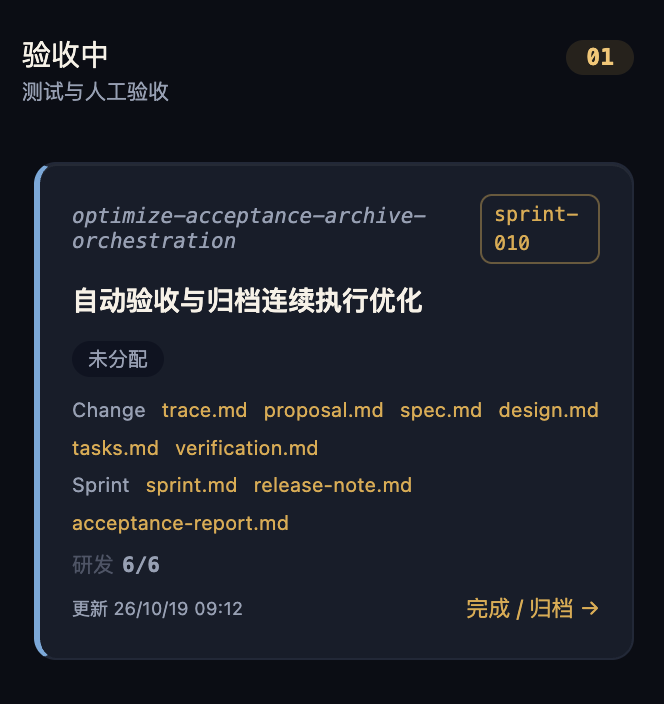

# 需求中心九阶段卡片宽度不足导致迭代标签换行

## 现象

需求中心九阶段看板使用统一 320px 列宽。当卡片同时显示较长的 Change ID 和 Sprint 标签时，右侧 `sprint-010` 被拆为 `sprint-` 与 `010` 两行，卡片顶部信息不易扫描。用户要求九阶段统一扩宽至 380px，并保证 Sprint 标签不再受长 ID 挤压换行。

## 环境与复现步骤

- 环境：本地 Web，Chrome，页面 `/requirements`；已有运行态采样视口为 1470×697。
- 前置：有包含长 Change ID 和 Sprint 归属的可见卡片。

1. 进入需求中心，定位 `optimize-acceptance-archive-orchestration` 卡片。
2. 查看同一顶部行中的 Change ID 和 `sprint-010` 标签。
3. 观察标签在连字符处换行，并检查 `.rc-board`、`.rc-column`、`.rc-card-top` 和 `.rc-sprint-tag` 的计算样式。

附件截取时卡片位于验收中，同会话浏览器取证时位于已完成。该状态变化不属于本缺陷；共用卡片样式仍显示换行问题。浏览器样本未刷新，仅证明已加载页面布局，不证明当前后端连通性。

## 期望与实际

| 项目 | 期望 | 实际 |
|---|---|---|
| 九阶段列宽 | 统一 380px，卡片随列扩宽 | 九列均为 320px |
| Sprint 标签 | 完整单行，不被长 ID 压缩，不溢出卡片 | 标签允许压缩及换行，出现两行 |
| 长 ID | 在剩余空间合理换行，完整可读 | 与标签争用同一 flex 行空间 |
| 看板布局 | 列头与列体对齐，保留横向滚动与空列布局 | 扩宽后的表现尚待实施验证 |

## 影响范围与严重等级

- 影响需求中心九个阶段的共用列布局，以及需求、BUG、独立 Change 的共用卡片；已观察到的触发样本为长 ID 的独立 Change。
- 无 Sprint 标签的卡片也应随列统一扩宽；标签修复仅作用于实际显示 Sprint 的卡片，不新增标签显示阶段。
- 严重度 low：影响视觉可读性，已有证据未显示业务操作阻断、数据损坏或权限问题。
- 本次记录不修改 API、数据库、部署、安全、客户端生成物或业务状态逻辑；后续实现需要同步 UI 契约和相关布局回归验证。

## 根因判断与证据

根因状态：confirmed（限已观察的布局缺陷，不代表修复已验证）。

| 编号 | 类型 | 来源 | 可复核事实 |
|---|---|---|---|
| E1 | screenshot | `screenshots/sprint-tag-wrap.png` | 长 Change ID 旁的 `sprint-010` 在连字符后换行。 |
| E2 | computed_style | 同会话 explore 的 Chrome 只读采样，摘要见 `capture.md` | 九列计算宽度均为 320px；标签 white-space 为 normal、flex-shrink 为 1，高度 35px。 |
| E3 | code_path | `src/web/src/styles/globals.css`，`.rc-board`、`.rc-card-top`、`.rc-sprint-tag` | 网格固定 `repeat(9, 320px)`；顶部使用 flex；标签未设置禁止换行与禁止压缩。生成文档时已复核代码仍一致。 |
| E4 | code_path | `src/web/src/pages/catalog/RequirementCenterPage.tsx`，共用卡片渲染 | ID 的 strong 与 Sprint 标签 span 同处 `.rc-card-top`，符合空间竞争的触发条件。 |

有限列宽与长 ID 同排导致可用空间不足，Sprint 标签在默认可收缩、可换行的样式下于连字符处折行。截图、运行态样式和代码路径共同解释现象。缺陷是标签显示布局问题，不是 Sprint 字段缺失；样本已有完整 `sprint-010` 文本。仅增加列宽不能保证更长 ID 下的标签稳定，需同时约束标签和 ID 的空间分配。

## 修复范围建议

1. 将共用九列宽度从 320px 调整为 380px，避免逐阶段设置造成差异。
2. 为 Sprint 标签设置单行与禁止压缩约束；长 ID 在剩余空间内合理换行，避免文字重叠或溢出。
3. 保留当前字体、颜色、卡片动作、文档入口、阶段投影和横向滚动行为。

## 后续验收要点

- 在 1440px 基准与窄视口采集截图及计算样式，验证九列均为 380px、列头与卡片对齐、可横向访问全部九阶段。
- 验证长 ID、超长无空格 ID、短 ID、有无 Sprint 标签组合；标签单行且边界在卡片内，ID 不覆盖标签。
- 覆盖需求、BUG、独立 Change 卡片和空列；文档入口及阶段动作可见、可操作。
- 尚未实施修复，未执行修复回归测试；380px 布局及新增样式需在后续 OpenSpec 实施中验证。

## 附件

