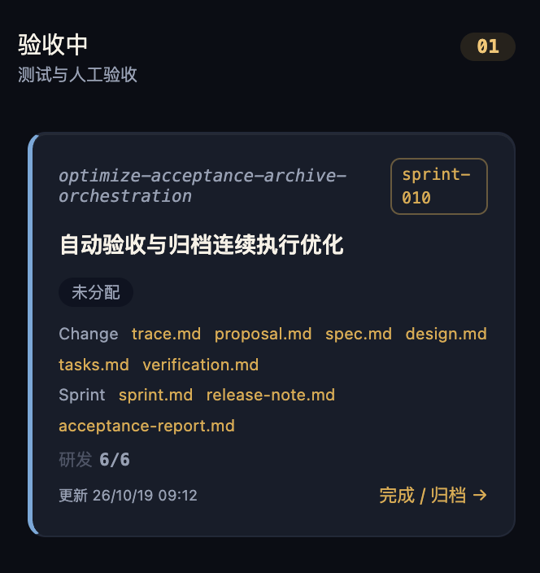

# 需求中心九阶段卡片宽度不足导致迭代标签换行

## 现象

需求中心九阶段看板列宽均为 320px。长 Change ID 与 Sprint 标签同排时，标签受到挤压，`sprint-010` 被拆成两行，影响扫描阅读。用户明确要求九个阶段统一扩宽至 380px，并修复标签受长 ID 挤压换行。

## 复现步骤

1. 打开本地 Web `/requirements` 页面。
2. 定位具有长 Change ID 和 `sprint-010` 标签的卡片，例如 `optimize-acceptance-archive-orchestration`。
3. 观察卡片顶部 ID 和迭代标签；附件中对象处于验收中，同会话浏览器取证时已处于已完成，布局问题仍存在。

## 期望与实际

- 期望：九列统一为 380px，卡片随列扩宽，列头和列体对齐；Sprint 标签保持单行、不被压缩，长 ID 在剩余空间合理换行。
- 实际：九列为 320px，Sprint 标签允许换行且可压缩，长 ID 与其竞争同一行空间。
- 保留横向滚动、既有阶段动作、字体与文档入口；不改变业务状态和数据契约。

## 已有证据

| 来源 | 观察 |
|---|---|
| 用户附件 | `screenshots/sprint-tag-wrap.png` 显示迭代标签拆成两行。 |
| 同会话 Chrome 只读取证 | 本地 `/requirements`，视口 1470×697；九个 `.rc-column` 均为 320px，`.rc-board` 为九列 320px；`.rc-sprint-tag` 的 white-space 为 normal、flex-shrink 为 1、高度 35px。未刷新，不据此判断当前服务连通性。 |
| 源码 | `src/web/src/styles/globals.css` 的 `.rc-board` 使用 `repeat(9, 320px)`；`.rc-card-top` 为 flex，`.rc-sprint-tag` 缺少禁止换行与禁止收缩约束。 |
| 渲染路径 | `src/web/src/pages/catalog/RequirementCenterPage.tsx` 中 ID 与 Sprint 标签共用 `.rc-card-top`。 |

## 建议验收

- 在 1440px 基准及窄视口验证九列计算宽度均为 380px、卡片与列头对齐、横向滚动正常。
- 长 Change ID 与 Sprint 标签同时出现时，标签完整单行且不溢出卡片，ID 合理换行。
- 检查需求、BUG、独立 Change 卡片及空列，文档入口与阶段动作无布局回归；采集截图和 computed style。

## 分级与判重

严重度初判 low：属于视觉可读性问题，现有证据未显示业务操作阻断或数据损失。两项调整属于同一页面和一次布局修复，合为一条缺陷。

已检查 BUG 注册表与当前态索引。BUG-0039 涉及 Sprint 归属误报、BUG-0038 涉及迭代数据缺失、BUG-0028 涉及卡片负责人显示，均仅页面弱相关，触发条件及修复面不同；未发现同一宽度或标签换行缺陷。

## 附件

